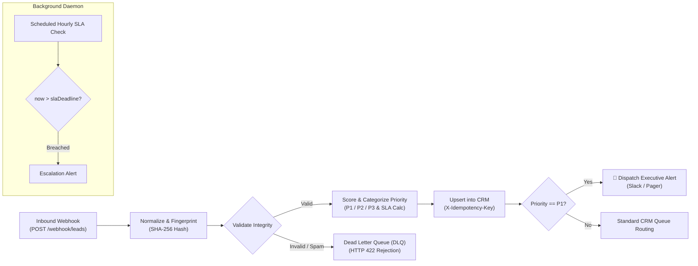

# Intelligent Lead-to-CRM Automation System

[](#-test-results--empirical-evidence)
[](https://n8n.io)
[](#-architecture-overview)
[](LICENSE)

A tested reference architecture for B2B Lead Ingestion, Deduplication, Dynamic Qualification, and CRM Routing engineered with **n8n**, a high-performance **REST CRM microservice**, and persistent **SQLite (WAL mode)** storage.

---

## 🌟 Executive Overview

In modern B2B sales operations, lead conversion velocity is directly dictated by triage speed and data hygiene. Inbound leads frequently arrive with malformed data, duplicates across marketing channels, or sit unaddressed in generic inboxes for hours.

This system provides an **autonomous, end-to-end integration architecture** that:
1. **Ingests leads via Webhook** from landing pages, contact forms, or partner portals.
2. **Enforces data integrity**: Validates RFC 5322 email syntax, mandatory company fields, non-negative budgets, and catches spam bot heuristics.
3. **Enforces Idempotency**: Employs SHA-256 cryptographic fingerprinting (with fail-closed Node.js crypto assertion) to detect duplicate submissions and prevent duplicate CRM records.
4. **Calculates Priority & SLAs Dynamically**:
   - **P1 (Enterprise Tier)**: Budget ≥ \$50k or 500+ org size ➔ **1-Hour SLA** ➔ Local Executive Alert record in CRM registry.
   - **P2 (Mid-Market Tier)**: Budget ≥ \$10k or 50-250 org size ➔ **4-Hour SLA** ➔ Commercial SDR routing.
   - **P3 (Standard SMB)**: Budget < \$10k ➔ **24-Hour SLA** ➔ Marketing nurture automation.
5. **Enforces Fault Tolerance & Recovery**: Implements bounded exponential backoff retries against transient API outages and routes unprocessable leads to a Dead Letter Queue (DLQ).
6. **Maintains Tamper-Evident Audit Trails**: Logs every lifecycle transition with timestamped audit entries in SQLite (WAL mode).

---

## 🏗️ Architecture Overview



Detailed architectural diagrams and sequence flows are documented in [docs/ARCHITECTURE.md](docs/ARCHITECTURE.md).

---

## 📁 Repository Structure

```text
github-workflow-demo/
├── .env.example                     # Environment configuration reference
├── .gitignore                       # Git exclusions (credentials, databases, logs)
├── docker-compose.yml               # Multi-container stack (n8n + Mock CRM)
├── workflow.json                    # Primary n8n Lead Ingestion & Qualification workflow
├── sla-monitor-workflow.json        # Companion n8n SLA Monitoring & Escalation workflow
├── run-all-tests.js                 # Master QA test runner (Unit, Integration, E2E, Security)
├── validate-workflow.js             # n8n structural & connection graph validator
├── lib/
│   └── lead-processor.js            # Pure validation, fingerprinting, and scoring engine
├── mock-crm/
│   ├── package.json                 # Microservice manifest
│   ├── database.js                  # Persistent SQLite engine (node:sqlite)
│   └── server.js                    # REST API server (Leads, Alerts, DLQ, Chaos simulator)
├── tests/
│   ├── fixtures/                    # Synthetic test payloads (Enterprise, Mid-Market, SMB, Invalid, Duplicate)
│   ├── unit/                        # Unit tests (Validation regex, Priority scoring, SLA math)
│   ├── integration/                 # Integration tests (CRM endpoints, Idempotency, Chaos/Retries)
│   ├── e2e/                         # End-to-end tests (Full pipeline & persistence across restarts)
│   └── security/                    # Security audit (Zero secrets & sensitive key scanning)
└── docs/
    ├── ARCHITECTURE.md              # In-depth architectural specifications & sequence diagrams
    ├── CASE-STUDY.md                # Technical case study, problem statement & trade-offs
    └── DEMO-GUIDE.md                # Step-by-step local execution & reproduction instructions
```

---

## 🧪 Test Results & Empirical Evidence

The system includes an automated test harness covering the complete lifecycle:

```text
================================================================
  INTELLIGENT LEAD-TO-CRM SYSTEM: AUTOMATED QA TEST RUNNER
================================================================

Executing [Schema / Unit]: 1. Workflow Graph & Schema Validation... PASS (61ms)
Executing [Unit]: 2. Unit: Data Validation & Normalization... PASS (68ms)
Executing [Unit]: 3. Unit: Priority Scoring & SLA Calculation... PASS (67ms)
Executing [Mock Integration]: 4. Integration: Mock CRM REST API & Idempotency... PASS (191ms)
Executing [Mock Integration]: 5. Integration: Chaos & Bounded Retry Recovery... PASS (485ms)
Executing [Adversarial Security]: 6. Security: Negative & Adversarial Attack Surface... PASS (143ms)
Executing [Simulated E2E]: 7. E2E: Full Pipeline & Persistence Across Restarts... PASS (325ms)
Executing [Static Security Audit]: 8. Security: Zero-Secrets & Credentials Audit... PASS (79ms)
Executing [Real Live E2E (Docker)]: 9. E2E: Genuine Real Docker + n8n Live HTTP... PASS (73028ms)

================================================================
                     QA TEST EXECUTION SUMMARY                  
================================================================
┌─────────┬───────────────────────────────────────────────────────┬──────────────────────────┬────────┬───────────┬──────────┐
│ (index) │ Suite                                                 │ Tier                     │ Status │ Duration  │ ExitCode │
├─────────┼───────────────────────────────────────────────────────┼──────────────────────────┼────────┼───────────┼──────────┤
│ 0       │ '1. Workflow Graph & Schema Validation'               │ 'Schema / Unit'          │ 'PASS' │ '61ms'    │ 0        │
│ 1       │ '2. Unit: Data Validation & Normalization'            │ 'Unit'                   │ 'PASS' │ '68ms'    │ 0        │
│ 2       │ '3. Unit: Priority Scoring & SLA Calculation'         │ 'Unit'                   │ 'PASS' │ '67ms'    │ 0        │
│ 3       │ '4. Integration: Mock CRM REST API & Idempotency'     │ 'Mock Integration'       │ 'PASS' │ '191ms'   │ 0        │
│ 4       │ '5. Integration: Chaos & Bounded Retry Recovery'      │ 'Mock Integration'       │ 'PASS' │ '485ms'   │ 0        │
│ 5       │ '6. Security: Negative & Adversarial Attack Surface'  │ 'Adversarial Security'   │ 'PASS' │ '143ms'   │ 0        │
│ 6       │ '7. E2E: Full Pipeline & Persistence Across Restarts' │ 'Simulated E2E'          │ 'PASS' │ '325ms'   │ 0        │
│ 7       │ '8. Security: Zero-Secrets & Credentials Audit'       │ 'Static Security Audit'  │ 'PASS' │ '79ms'    │ 0        │
│ 8       │ '9. E2E: Genuine Real Docker + n8n Live HTTP'         │ 'Real Live E2E (Docker)' │ 'PASS' │ '73028ms' │ 0        │
└─────────┴───────────────────────────────────────────────────────┴──────────────────────────┴────────┴───────────┴──────────┘
Total Execution Time: 74.45s
Overall Result: ALL EXECUTED SUITES PASSED (100% GREEN)
================================================================
```

---

## 🚀 Quick Start Guide

### Option 1: Run Local Tests Immediately
```bash
# Clone and enter directory
git clone https://github.com/Jk-7bod7/ai-agent-workflow-demo.git
cd ai-agent-workflow-demo

# Run all 9 test suites (Suites 1-8 run in ~1.5s; Suite 9 executes against Docker if active)
node run-all-tests.js
```

### Option 2: Run Full Docker Compose Stack
```bash
docker compose up -d
```
- **n8n Webhook Interface**: `http://localhost:5678`
- **Mock CRM REST API**: `http://localhost:3001`

Detailed testing and payload guides are available in [docs/DEMO-GUIDE.md](docs/DEMO-GUIDE.md).

---

## 🛡️ Security, Privacy & Integrity Notice

- **CRM Integration**: Implemented via a dedicated Mock CRM REST API running on **Node.js 22 LTS (`node:22-alpine`)** with persistent SQLite (`node:sqlite`). Requires `Authorization: Bearer <token>` for all endpoints (except `/api/v1/health`).
- **Webhook Authentication**: Webhook requires `X-Webhook-Secret` header to prevent unauthenticated injection.
- **Alert Dispatch**: Alerts are recorded in the local CRM alert registry and audit log table (`alerts` table) for notification review. No external Slack API delivery is claimed or performed.
- **n8n Task Runner**: Configured with `NODE_FUNCTION_ALLOW_BUILTIN=crypto` to permit secure cryptographic hashing within Code nodes.
- **Data**: All lead records, names, companies, and emails are 100% synthetic test fixtures.

---

## 📄 License

MIT License. Free for evaluation, portfolio review, and educational implementation.
