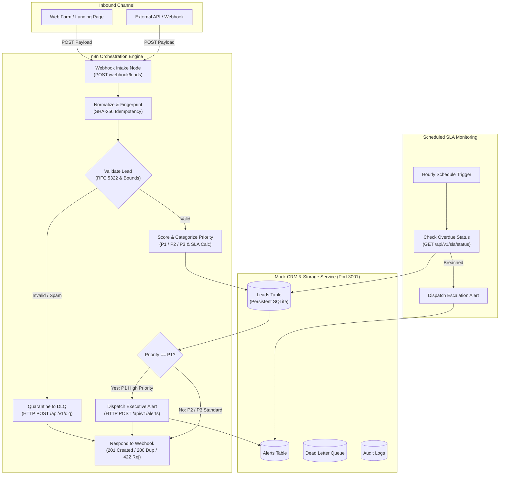
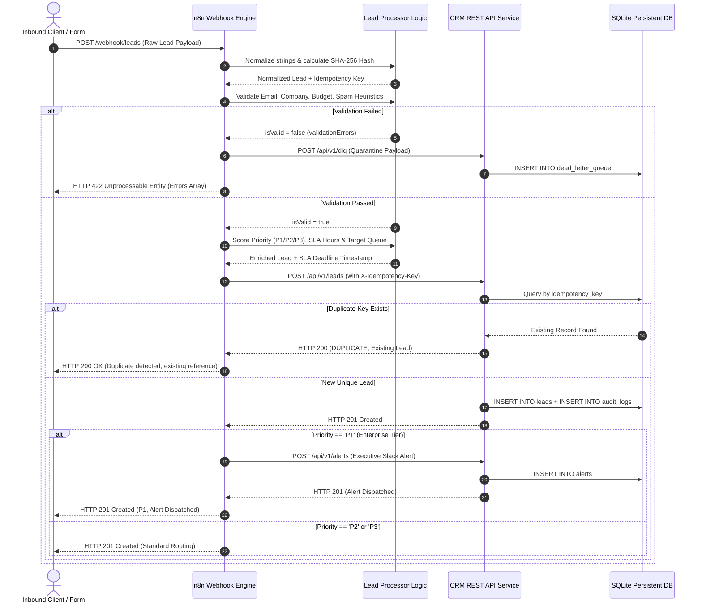

# System Architecture: Intelligent Lead-to-CRM Automation

## 1. System Overview

The **Intelligent Lead-to-CRM Automation System** is an enterprise-grade integration pipeline designed to ingest, validate, deduplicate, score, and route inbound business leads into CRM storage while dispatching real-time notifications for high-priority opportunities and monitoring SLA deadlines.

---

## 2. Sequence Diagram (End-to-End Execution Flow)

---

## 3. Core Architectural Principles

### 1. Deterministic Idempotency
- Every incoming lead is normalized (whitespace trimmed, email lowercased).
- A deterministic SHA-256 hash is computed over `email|company|fullname`.
- The hash is transmitted via HTTP Header `X-Idempotency-Key` to the CRM API.
- If a network retry or client resubmission occurs, the database detects the existing key and returns `HTTP 200 DUPLICATE` without creating redundant records or firing duplicate alerts.

### 2. Strict Qualification & Dynamic SLA Computation
- **P1 (Enterprise)**: Budget ≥ \$50,000 OR Company Size `500+` / `250-500`.
  - SLA: **1 hour**.
  - Routing: `enterprise_exec_sales`.
  - Action: Immediate Slack/SMS alert dispatch to Senior Account Director.
- **P2 (Mid-Market)**: Budget ≥ \$10,000 OR Company Size `50-250`.
  - SLA: **4 hours**.
  - Routing: `midmarket_sales`.
  - Action: Enqueue for dedicated Account Executive.
- **P3 (Standard SMB)**: Budget < \$10,000 and Company Size `1-10`.
  - SLA: **24 hours**.
  - Routing: `marketing_nurture`.
  - Action: Automated email onboarding sequence.
- **SLA Calculation**: `sla_deadline = submittedAt + (slaTargetHours * 3600s)`. Stored in ISO 8601 UTC format.

### 3. Resilience & Failure Handling
- **Dead Letter Queue (DLQ)**: Quarantines malformed, spam, or rejected leads with exact validation failure reasons for compliance and review.
- **Bounded Exponential Backoff**: n8n HTTP Request node and client adapters implement bounded retries (3 attempts with exponential backoff: 50ms, 100ms, 200ms) to withstand transient 503 network errors without entering infinite loops.
- **Tamper-Evident Audit Trail**: Every lifecycle event (`LEAD_CREATED`, `DUPLICATE_INGESTION_ATTEMPT`, `ALERT_DISPATCHED`, `DEAD_LETTER_QUEUED`) is appended to an immutable `audit_logs` table.
